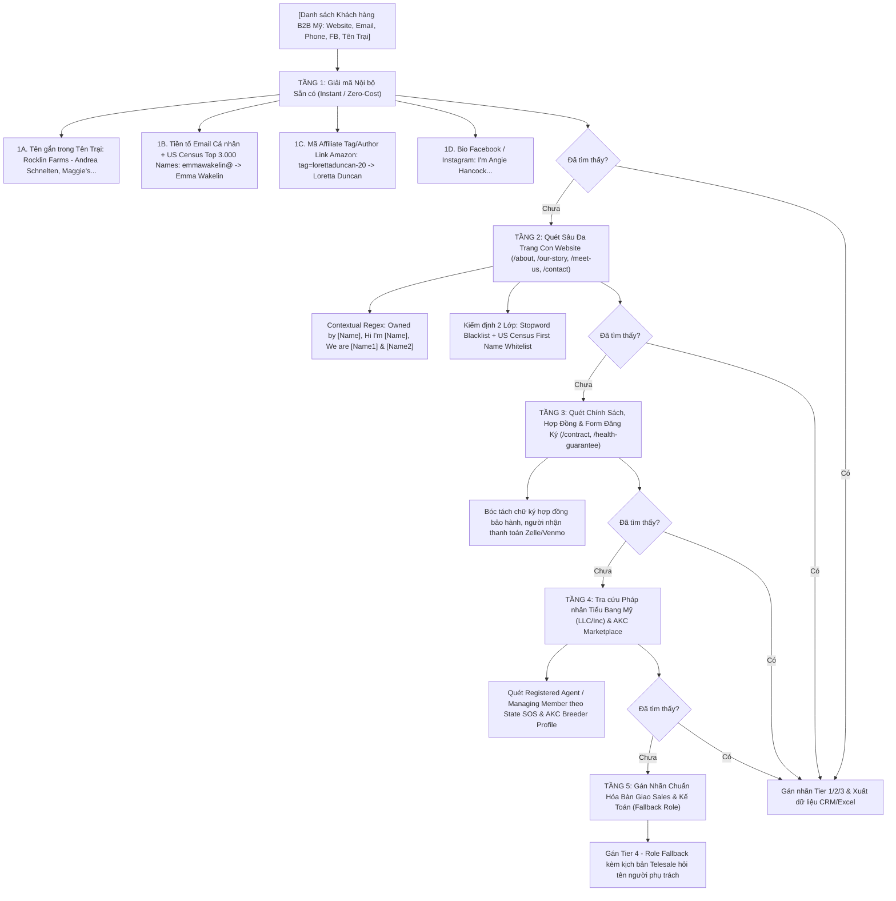

# Kỹ năng: Pet Grass, Potty & Toys Lead Finder (Định vị, Phân loại & Chấm điểm Khách hàng Tiềm năng)

## 1. Bối cảnh Doanh nghiệp & 3 Dòng Sản phẩm Cốt lõi
Hệ thống / Cửa hàng đang kinh doanh và tìm kiếm đối tác, khách hàng tiềm năng xoay quanh **3 nhóm sản phẩm chính**:

1. **Cỏ nhân tạo cho thú cưng (Artificial Grass / Dog Turf / Grass Patch / Pee Mat):**
   * *Mục đích:* Lót sân vườn cho chó chạy nhảy, lót chuồng trại huấn luyện, thảm cỏ ban công/sân thượng cho cún đi vệ sinh thoát nước nhanh, không bám bẩn.
   * *Từ khóa nhận diện:* `artificial grass`, `dog turf`, `grass patch`, `turf pad`, `real grass`, `dog lawn`, `fresh patch`, `doggie lawn`, `grass mat`.

2. **Nhà vệ sinh & Dụng cụ vệ sinh cho thú cưng (Pet Toilets / Potty / Pee Pads / Litter):**
   * *Mục đích:* Giải pháp đi vệ sinh trong nhà (indoor potty training) cho cún cưng, đặc biệt là cún con mới về nhà mới hoặc sống trong căn hộ chung cư.
   * *Từ khóa nhận diện:* `potty`, `dog toilet`, `pee pad`, `puppy pad`, `wee wee pad`, `potty tray`, `indoor dog potty`, `porch potty`, `litter box`, `potty training`.

3. **Đồ chơi thú cưng (Pet Toys / Chew Toys / Interactive Toys):**
   * *Mục đích:* Đồ chơi ngứa răng cho cún con (teething), đồ chơi xoa dịu stress khi xa mẹ (Snuggle Puppy), đồ chơi gặm sạch răng (dental chew), đồ chơi tương tác (KONG, rope).
   * *Từ khóa nhận diện:* `chew toy`, `dog toy`, `puppy toy`, `plush toy`, `rope toy`, `squeaky toy`, `interactive toy`, `teething`, `kong`, `nylabone`, `snuggle puppy`.
   * *LƯU Ý QUAN TRỌNG:* Loại trừ các từ chỉ giống chó như `Toy Poodle`, `Toy Breed`, `Toy Australian Shepherd` (đây là tên giống chó, KHÔNG PHẢI đồ chơi).

### 1.1. Phạm vi Địa lý Chiến lược: 100% Tập trung Thị trường Mỹ (US Target Market)
* **Thị trường Trọng tâm Giai đoạn 1 (Current Primary Focus):**
  * Toàn bộ chiến dịch tiếp thị, hạ tầng kho vận FBA Amazon, hệ thống CRM và đội ngũ Sales hiện tại **tập trung đánh chiếm 100% thị phần tại Hoa Kỳ (United States / USA)**.
  * Mọi khách hàng tiềm năng đưa vào bảng ưu tiên (Priority List), tính điểm Hot Leads và gửi cho đội Sales liên lạc telesale/email **bắt buộc phải thuộc thị trường Mỹ** (Phone định dạng Bắc Mỹ `+1`, 50 tiểu bang Hoa Kỳ, mã bưu chính Zip Code US 5 chữ số).
* **Kế hoạch Mở rộng Tương lai (Future Expansion):**
  * Các thị trường quốc tế (Canada, Vương quốc Anh, Úc, Châu Âu...) sẽ được kích hoạt mở rộng sau khi công ty hoàn thành mục tiêu chiếm lĩnh thị trường nội địa Mỹ.
  * Trong giai đoạn này, nếu phát hiện các đối tác ngoài nước Mỹ, hệ thống tự động gắn cờ `International / Future Expansion` để lưu trữ dữ liệu phễu dự phòng, **tuyệt đối không chuyển sang đội Sales telesale trực diện**.

---

## 2. Tiêu chí Thu thập & Điểm Chuẩn Hồ sơ Khách hàng (Từ `marketing_parameter.html`)

> [!IMPORTANT]
> **NGUYÊN TẮC VÀNG VỀ MÔ HÌNH CHẤM ĐIỂM (GROUND-TRUTH SCORING ARCHITECTURE):**
> * **Nguồn chuẩn mực số 1 (Hồ sơ Tĩnh - Baseline Ground Truth):** Được tính trực tiếp trên **Danh sách trích xuất thông tin người dùng** (`List_Info_User.xlsx` / `priority_list_2026-10-06_v2.xlsx`) dựa vào bộ quy chuẩn 13 trường tại Mục 02 và thang điểm Lead Score tại Mục 04 của `Datasets/marketing_parameter.html`. Đây là căn cứ quyết định phân cấp A/B/C/D và tiềm năng mua sỉ dài hạn.
> * **Nguồn bổ trợ số 2 (Hành vi Động - Dynamic Boost):** File `List_Action_user.xlsx` ghi nhận các sự kiện tương tác số (Click, Comment Reels, Web Pixel), chỉ dùng để **cộng điểm thưởng tương tác nóng (Hot Boost) và tính hệ số suy giảm thời gian (Time Decay)**, không thể dùng độc lập để chấm điểm hồ sơ vì thiếu các trường dữ liệu tĩnh nền tảng (Website, Puppy page, Application, Review, Giống chó).

### 2.1. 15 Trường Dữ liệu Thu thập Quan trọng (Updated Data Structure for Sales & Accounting)
Ngoài 13 trường nền tảng từ `marketing_parameter.html`, mọi danh sách xuất ra cho Bộ phận Sales và Bộ phận Kế toán bắt buộc phải bổ sung **Trường số 14 và 15** để định danh người ra quyết định mua hàng (Decision Maker):
1. **Breeder Name** (Tên trại chó / người nhân giống) - ★★★★★
2. **Website** (Website chính thức) - ★★★★★
3. **Email** (Email kinh doanh/giao dịch) - ★★★★★
4. **Phone** (Số điện thoại) - ★★★★☆
5. **State / City** (Bang / Thành phố tại Mỹ) - ★★★★☆
6. **Breed** (Các giống chó đang nhân giống) - ★★★★★
7. **Facebook** (Trang Facebook / Profile hoạt động) - ★★★★☆
8. **Instagram** (Tài khoản Instagram) - ★★★★☆
9. **Puppy Page** (Có trang bán cún con riêng biệt hay không) - ★★★★★
10. **Online Application** (Có form đăng ký mua cún online hay không) - ★★★★★
11. **Reviews** (Số lượng & điểm đánh giá Google/Facebook) - ★★★☆☆
12. **Online Store** (Có cửa hàng bán phụ kiện/đồ dùng online hoặc Amazon) - ★★★★☆
13. **Current Kit** (Hiện tại có cung cấp gói quà Take-Home Kit cho khách nhận cún không) - ★★★★★
14. **Owner_Representative (Chủ sở hữu / Người đại diện pháp lý - Decision Maker)** - ★★★★★
    * *Mục đích cho Sales:* Cá nhân hóa lời chào mở đầu ("Hi Javin / Hi Tanya, ...") giúp tăng gấp 2.5 lần tỷ lệ bắt máy và phản hồi email so với gửi chung chung ("Dear Breeder").
    * *Mục đích cho Bộ phận Kế toán:* Điền chính xác tên Người nhận vào Báo giá thương mại (`Attention: [Owner_Representative]` trên Commercial Quote / BOM), xác minh chủ thẻ/tài khoản thanh toán và lập phiếu xuất kho `Sample Kit`.
15. **Owner_Confidence & Evidence_Source (Cấp độ Xác thực & Nguồn Bằng chứng Chủ sở hữu)** - ★★★★☆
    * Phân định theo thứ bậc ưu tiên 3 tầng tuyệt đối (TUYỆT ĐỐI KHÔNG DÙNG placeholder chung chung như `Breeder Owner / Manager` hoặc `Kennel Owner`):
      - `Tier 1 - High (Website About/Home/Contact/Good Dog Verified)`: Mở tab trình duyệt trực quan quét sâu trang web chính thức, Schema.org, Header `Meet [Name]`, Image Alt text hoặc hồ sơ Good Dog (vd: `Amanda Bexley`, `Lisa Z.`).
      - `Tier 2 - Medium-High (Email Prefix Name Match)`: Tự động phân tích tiền tố của Gmail trước dấu `@` khi web không ghi tên (vd: `amandabexleyab@gmail.com` $\rightarrow$ `Amanda Bexley`, `roleezyorkies@gmail.com` $\rightarrow$ `Roleez Yorkies`).
      - `Tier 3 - Medium (Facebook Page Name Fallback)`: Khi không có email hoặc email chung chung (`contact@`, `info@`), lấy thẳng tên Fanpage/Profile trên Facebook (`lead.name`).

### 2.2. Phân loại Cấp bậc Đối tác (A - B - C - D) & Hành động của Đội Sales (Mục 03)
* **Cấp A (A级: Điểm $\ge$ 61 - Trọng điểm Sales / Ưu tiên Cao nhất):**
  * *Tiêu chuẩn:* Có website chuẩn + trang bán puppy riêng + mạng xã hội hoạt động tích cực + nhân giống nhiều giống chó/quy mô lớn + có kênh bán hàng online/Amazon.
  * *Hành động Sales:* Đội sales ưu tiên liên hệ trực tiếp bằng điện thoại trong ngày, chào gói quà tặng Puppy Kit V2/V3 (có in logo thương hiệu của trại).
* **Cấp B (B级: Điểm 45 - 60 - Quy mô Trung bình / Tiềm năng):**
  * *Tiêu chuẩn:* Có website và thông tin liên hệ đầy đủ, quy mô vừa phải.
  * *Hành động Sales:* Tiếp cận tự động qua chuỗi email marketing + chăm sóc bổ sung bằng telesale.
* **Cấp C (C级: Điểm 30 - 44 - Tiềm năng Tầm trung / Chi phí thấp):**
  * *Tiêu chuẩn:* Chỉ có trang Facebook hoặc định vị Google Maps, chưa có website riêng hoàn chỉnh.
  * *Hành động Sales:* Nhắn tin trực tiếp chi phí thấp qua Fanpage Facebook/Instagram.
* **Cấp D (D级: Điểm < 30 - Tạm hoãn / Đóng băng):**
  * *Tiêu chuẩn:* Thông tin không đầy đủ, website bị hỏng (dead link) hoặc nhiều năm không hoạt động.
  * *Hành động Sales:* Tạm thời lưu trữ, không tốn tài nguyên bán hàng.

### 2.3. Bảng Điểm Chuẩn Hồ sơ Khách hàng (Mục 04 của `marketing_parameter.html`)
* Có Website chính thức (有官方网站): **+5 điểm**
* Có trang bán Puppy (`Puppy Page` - 有Puppy销售页面): **+10 điểm**
* Có Form đăng ký mua cún (`Online Application` - 是否在线申请购买): **+10 điểm** *(kinh doanh bài bản, mức độ thương mại hóa cao)*
* Facebook hoạt động đều đặn (Facebook活跃): **+5 điểm**
* Instagram hoạt động đều đặn (Instagram活跃): **+5 điểm**
* Đạt từ 10+ đánh giá trở lên (10+评价): **+5 điểm**
* Nhân giống nhiều giống chó / Giống cao cấp (多个犬种): **+5 điểm**
* Có Online Store / Gian hàng Amazon (是否销售宠物用品): **+10 đến +15 điểm**
* Hiện tại cung cấp Take-Home Kit (Current Kit): **+10 điểm**
* Tương tác trang web (Web Tracking Events):
  * Xem sản phẩm Puppy Kit: **+10 điểm**
  * Xem bảng giá (View Pricing / BOM): **+15 điểm**
  * Gửi form liên hệ (Inquiry): **+30 điểm**
  * Yêu cầu gửi mẫu thử (Sample Kit): **+50 điểm**
  * Nhận báo giá thương mại (Quote): **+60 điểm**

---

## 3. Theo dõi Hành động & Mô hình Tính điểm Động (Từ `List_Action_user.xlsx`)

### 3.1. 6 Mã Kênh Tương tác & Trọng số Điểm Gốc (Base Score)
Hệ thống theo dõi khách hàng qua 6 kênh hành vi để phân loại tệp đối tượng (Audience):

| Mã Code (`code`) | Kênh (`channel`) | Trục (`axis`) | Base Score | Suy giảm (`decay`) | Tier mặc định | Tệp Đối tượng (`audienceName`) | Hành động Tiếp thị (`audienceAction`) |
| :--- | :---: | :---: | :---: | :---: | :---: | :--- | :--- |
| **`Own_Reels_Comment`** | 2 | engagement | **40** | **Có (True)** | **S** | **A3 Tương tác Trực tiếp** | **Ưu tiên cao nhất: Gọi điện Sales ngay + Remarketing** |
| **`Site_Pixel_Behavior`** | 6 | website | **30** | **Có (True)** | Dynamic | **A4/A5 Hành vi Website** | **Theo dõi CPL/ROAS, remarketing sâu theo trang đã xem** |
| **`AKC_Breeder_List`** | 1 | customer | **25** | Không (False) | **S** | **LAL Đối tượng Tương đồng** | Tạo tệp Seed mở rộng quy mô |
| **`Visual_High_Relevance`** | 4 | ai | **25** | **Có (True)** | **A** | **AI Thị giác Nhận diện Cao** | Đã phát hiện ảnh sân cỏ/chó con qua avatar, cover |
| **`Viral_Post_Engaged`** | 3 | engagement | **20** | **Có (True)** | **A** | **Tương tác Bài viết Viral** | Custom Audience + lấy ý tưởng làm nội dung kéo khách |
| **`Social_Network_L2`** | 5 | customer | **10** | Không (False) | Dynamic | **Tệp Mở rộng Sở thích L2** | Tầng đỉnh phễu (Top of Funnel) |

#   * `zeroWeightDays = 30`: Nếu quá **30 ngày** không có bất kỳ tương tác hoặc không đăng bài mới, điểm tương tác suy giảm về **0**.

### 3.4. Thuật toán Chống Bão hòa Điểm (Anti-Saturation Dynamic Scoring Engine)
Để tránh tình trạng "cào bằng" 100 điểm cho toàn bộ khách hàng, hệ thống bắt buộc sử dụng công thức tổng hợp đa tầng (5 trục đánh giá độc lập), phân bổ điểm số theo thang chuẩn:
$$\text{Total Score} = \text{Recency} (0-35) + \text{ICP Fit} (10-30) + \text{Breed Commercial Value} (0-15) + \text{Business Infrastructure} (0-10) + \text{Amazon Credibility} (0-15)$$

* **Trục 1 - Độ tươi mới tương tác (Action Recency: 0 - 35 điểm):**
  * Đăng bài / tương tác $\le 3$ giờ qua: **35 điểm**
  * Trong vòng 4 - 24 giờ qua: **32 điểm**
  * Trong vòng 1 - 3 ngày qua: **28 điểm**
  * Trong vòng 4 - 7 ngày qua: **20 điểm**
  * Trong vòng 8 - 14 ngày qua: **15 điểm**
  * Trong vòng 15 - 30 ngày qua: **8 điểm**
  * Quá 30 ngày: **0 điểm** (hết hạn tương tác)
* **Trục 2 - Mức độ phù hợp ICP (ICP Fit: 10 - 30 điểm):**
  * Dog Breeder / Trại chó chuyên nghiệp: **28 - 30 điểm** (Khách mua kit số lượng lớn)
  * Pet Boarding / Huấn luyện chó K9: **20 - 22 điểm** (Khách mua cỏ sân chơi & đồ chơi nhai)
  * Pet Rescue / Trạm cứu trợ: **14 - 16 điểm** (Khách mua tã lót & khay vệ sinh)
  * Pet Owner / Người nuôi cá nhân: **10 điểm**
* **Trục 3 - Giá trị Thương mại của Giống chó (Breed Commercial Value: 0 - 15 điểm):**
  * Giống chó thương mại phân khúc cao (French Bulldog, English Bulldog, Bernedoodle, Goldendoodle, Cavapoo, Corgi, Malinois, German Shepherd, Labrador, Golden Retriever, Rottweiler, Bully):
    * Sở hữu từ 2 giống giá trị cao trở lên: **+15 điểm**
    * Sở hữu 1 giống giá trị cao: **+10 điểm**
  * Các giống cún cảnh phổ thông: **+5 điểm**
  * Không rõ giống: **0 điểm**
* **Trục 4 - Hạ tầng & Pháp nhân Doanh nghiệp (Business Infrastructure: 0 - 10 điểm):**
  * Có Website chính thức / Cửa hàng trực tuyến: **+5 điểm**
  * Có pháp nhân kinh doanh (Kennel, Farm, LLC, LTD) hoặc có Application Form: **+5 điểm**
* **Trục 5 - Tín nhiệm & Độ sẵn sàng Sàn Amazon (Amazon Credibility: 0 - 15 điểm):** Xem chi tiết tại Mục 4.

* **Phân tầng Hạng Khách hàng (Standard Tier Distribution):**
  * **Tier S (Kim Cương: 85 - 100 điểm):** Trại chó thương mại lớn, cực kỳ tích cực $\le 24$h, có uy tín Amazon và bán giống giá trị cao $\rightarrow$ **Gọi điện chốt hợp đồng ngay trong ngày**.
  * **Tier A (Vàng: 70 - 84 điểm):** Trại chó hoặc học viện huấn luyện hoạt động tích cực $\le 3$ ngày $\rightarrow$ **Email cá nhân hóa + Telesale**.
  * **Tier B (Bạc: 50 - 69 điểm):** Trại chó hoặc cơ sở chăm sóc hoạt động trong 4 - 14 ngày $\rightarrow$ **Chuỗi email marketing tự động**.
  * **Tier C (Đồng: 30 - 49 điểm):** Hoạt động thưa thớt (15 - 30 ngày) hoặc trạm cứu trợ $\rightarrow$ **Nuôi dưỡng nội dung mạng xã hội**.
  * **Tier D (Đóng băng: < 30 điểm):** Quá 30 ngày không hoạt động hoặc hồ sơ thiếu $\rightarrow$ **Lưu trữ chờ kích hoạt lại**.

---

## 4. Bảng Nhãn Phân loại Sàn Amazon & Điểm Tín nhiệm (Amazon Credibility Proof)

Sự hiện diện của gian hàng hoặc Wishlist Amazon là bằng chứng rõ nhất chứng minh đối tác **đang chi tiền hoặc giới thiệu sản phẩm cho khách hàng của họ**, giúp tăng độ tin cậy và tỷ lệ chốt deal:

| Nhãn Phân loại Amazon (`Phân loại Amazon`) | Điểm Tín nhiệm | Ý nghĩa Kinh doanh | Hành động của Team Sales |
| :--- | :---: | :--- | :--- |
| **`Selling pet toys + Artificial grass/Pet toilets (TARGET)`** | **+15** | Đối tác đang bán/khuyên dùng **cả 2 nhóm sản phẩm mục tiêu** (Đồ chơi + Cỏ/Khay vệ sinh). Tệp khách hàng hoàn hảo nhất! | Ưu tiên số 1: Giới thiệu trọn gói Take-Home Kit in logo độc quyền của trại. |
| **`Selling artificial grass/pet toilets (TARGET)`** | **+10** | Đang bán/khuyên dùng **Cỏ nhân tạo hoặc Khay/Nhà vệ sinh/Pee Pad**. | Chào thảm cỏ thoát nước và khay potty giá sỉ/BOM chiết khấu. |
| **`Selling pet toys`** | **+7** | Đang bán/khuyên dùng **Đồ chơi thú cưng** (KONG, gặm ngứa răng, Snuggle Puppy). | Chào combo đồ chơi huấn luyện và đồ chơi xoa dịu cún con. |
| **`There's an Amazon link, but no target sales.`** | **+3** | Có liên kết Amazon nhưng bán thức ăn, thuốc thú y, lồng chuồng thông thường. | Mời hợp tác mở rộng danh mục sang kit quà tặng cún con. |
| **`Amazon link not found`** | **0** | Chưa tìm thấy liên kết Amazon trên trang của đối tác. | Đặt câu hỏi mở đầu về việc chuẩn bị Take-Home Kit. |

---

## 5. Bộ lọc Âm tính (Negative Exclusion Filters) - Tuyệt đối Không đưa vào CRM

Hệ thống RAG và phân loại phải loại bỏ các tổ chức phi khách hàng (False Positives) trước khi chấm điểm:
1. **Hiệp hội phả hệ, CLB quốc gia phi lợi nhuận:** `American Kennel Club` (AKC), `Westminster Kennel Club`, `United Kennel Club` (UKC), `Canadian Kennel Club`, `FCI`, `Breed Clubs`. *(Lý do: Đây là cơ quan đăng kiểm/tổ chức cuộc thi, không phải nhà nhân giống bán cún con).*
2. **Chuỗi siêu thị bán lẻ thú cưng khổng lồ:** `PetSmart`, `Petco`, `Chewy`, `Pet Supplies Plus`.
3. **Kênh tin tức, tạp chí, truyền thông giải trí & meme:** `WeRateDogs`, `The Dodo`, `Dogster`, `Dogs Naturally Magazine`, `American Dog Fancier`, `Things Dog Handlers Say`.
4. **Công ty xét nghiệm gen DNA & tập đoàn thú y:** `Embark Vet`, `Zoetis`, `Revival Animal Health`, `Fear Free Pets`.

---

## 6. Kịch bản Tiếp cận & Thông điệp Bán hàng (Sales Angle)

* **Câu hỏi mở đầu kinh điển (Email & Telesale):**
  > *"Do you currently provide a puppy take-home package for your buyers?"*  
  > *(Hiện tại trại của anh/chị có chuẩn bị bộ quà tặng Take-Home Kit cho khách hàng khi họ đón cún con về nhà mới không?)*
* **Nếu khách trả lời CÓ (YES):**
  * Hỏi thành phần và chi phí hiện tại của họ $\rightarrow$ Đề xuất bản nâng cấp V2/V3 chuyên nghiệp hơn, bổ sung thảm cỏ nhân tạo tập đi vệ sinh và đồ chơi gặm ngứa răng có in logo trại.
* **Nếu khách trả lời CHƯA (NO):**
  * Giới thiệu giải pháp Take-Home Starter Kit trọn gói: Giúp nâng tầm thương hiệu trại chó, tăng sự an tâm cho người mua cún, hạn chế cún đi bậy trong nhà mới.

---

## 7. Chỉ thị Vận hành cho AI & Hệ thống RAG (Prompt & System Operating Rules)

1. **Tuân thủ Thuật toán Chống Bão hòa Điểm:** Tuyệt đối không cho ra danh sách mà tất cả khách hàng đều 100 điểm. Phải áp dụng công thức 5 trục độc lập tại Mục 3.4.
2. **Bắt buộc hiển thị Trường Amazon:** Trong mọi báo cáo phân tích và kết quả truy vấn RAG, phải có cột `Amazon Status / Trạng thái Amazon` để chứng minh độ uy tín.
3. **Ưu tiên Hiển thị Đa dạng Cấp bậc:** Bảng kết quả phải hiển thị cả các tầng Tier S, Tier A, Tier B cùng các giống chó khác nhau để đội ngũ tiếp thị có cái nhìn tổng quan toàn diện.
4. **Luôn xuất ra các cột rõ ràng:** Tên, URL, Website, Ngày hoạt động gần nhất (`lastActiveDays`), Điểm số chuẩn (`Lead Score`), Phân hạng (`Tier A/B/C/D`), Kênh Amazon (`Amazon Link` & `Amazon Status`), và Phân loại nhu cầu sản phẩm (Cỏ nhân tạo / Nhà vệ sinh / Đồ chơi).
5. **Hành động Sales Cụ thể:** Chỉ ra rõ trong danh sách khách nào là **Hot Lead (Hạng A/S, điểm ≥ 61)** để Sales xử lý ngay lập tức theo kịch bản Take-Home Kit V2/V3.
6. **Quy tắc Vận Hành RAG:** Hệ thống RAG khi truy vấn phải trích xuất trực tiếp từ danh sách thông tin người dùng đã xác minh (Ground Truth), ưu tiên lọc các đối tác có gian hàng Amazon bán cả 2 dòng sản phẩm mục tiêu (Đồ chơi + Cỏ/Potty) để cung cấp báo giá sỉ độc quyền.
7. **Quy tắc Phạm vi Địa lý (100% Thị trường Mỹ - USA Only):** Toàn bộ truy vấn RAG, lọc leads cho Sales, và phân tích chiến dịch chỉ quét khách hàng nội địa Mỹ (`Country == 'United States'`). Các thị trường quốc tế sẽ được xếp vào nhánh dữ liệu mở rộng sau này, không phân bổ ngân sách tiếp cận trong giai đoạn này.
8. **Quy tắc Bàn giao Dữ liệu Định danh cho Sales & Kế toán:** Mọi file Excel và báo cáo CRM bàn giao cho Bộ phận Sales telesale hoặc Bộ phận Kế toán làm báo giá/xuất kho bắt buộc phải có đầy đủ 2 trường: `Owner_Representative` (Tên Chủ sở hữu / Người đại diện pháp lý) và `Owner_Confidence` (Mức độ xác thực) để điền chính xác `Attention: [Owner_Representative]` trên Commercial Quote / BOM và gọi điện thoại trực tiếp người ra quyết định (Decision Maker).

---

## 8. Mô hình Tiếp thị Ngữ cảnh theo Thời tiết & Khí hậu (Weather Contextual Marketing Engine)

### 8.1. Cơ chế Kỹ thuật Lấy Dữ liệu Thời tiết từ Địa chỉ & IP
Dựa vào dữ liệu hồ sơ khách hàng đã có (`Country: US`, `Bang / State`, `Thành Phố / City`, `Mã Zip`), hệ thống hoàn toàn có thể tự động truy vấn thời tiết thời gian thực thông qua API OpenWeatherMap (đã tích hợp trong `天气预报.html`, API Key: `2e519601af416c660ebaa2323bee4f54`):
* **Truy vấn theo Zip Code (Độ chính xác cao nhất tại Mỹ):** `https://api.openweathermap.org/data/2.5/weather?zip={zip},US&units=imperial&appid={API_KEY}`
* **Truy vấn theo Thành phố & Bang:** `https://api.openweathermap.org/data/2.5/weather?q={city},{state},US&units=imperial&appid={API_KEY}`
* **Truy vấn qua IP Khách truy cập Web (Frontend Contextual Trigger):** Đọc địa chỉ IP người dùng -> Định vị Geolocation (Tọa độ hoặc Zip) -> Gọi API OpenWeatherMap để tự động đổi banner quảng cáo, pop-up và bảng giá theo thời tiết cục bộ.

### 8.2. 3 Kịch bản Kích hoạt Bán hàng theo Ngữ cảnh Thời tiết (Contextual Triggers)
1. **Trigger 1: Nhiệt độ Khắc nghiệt & Mưa Bão Tuyết (Bad Weather / Extreme Heat / Freezing) $\rightarrow$ Nhu cầu Thảm Cỏ & Khay Vệ sinh Tăng Vọt:**
   * *Điều kiện kích hoạt:* Mưa dầm dề (`Rain / Drizzle`), Tuyết rơi (`Snow`), Băng giá (`Temp < 40°F / 4°C`), hoặc Nắng nóng gay gắt mặt đường bê tông bỏng rát (`Temp > 90°F / 32°C`).
   * *Hành vi người nuôi:* Chủ ngại dắt chó ra đường, cún con dễ bị cảm lạnh hoặc sốc nhiệt, chân ướt vấy bẩn sàn nhà.
   * *Kịch bản Bán hàng (Sales / Ads Angle):* Đẩy mạnh **Thảm cỏ nhân tạo thoát nước (Pet Turf Pad)** và **Khay vệ sinh trong nhà (Indoor Potty Tray)**.
   * *Thông điệp Telesale/Email:* *"Trời mưa dầm dề / nắng gắt mặt đường nóng bỏng, bảo vệ cún cưng với giải pháp đi vệ sinh sạch sẽ ngay tại nhà!"*
2. **Trigger 2: Chó bị "Cuồng Chân" do Nhốt Trong Nhà Lâu Ngày $\rightarrow$ Kích hoạt Đồ Chơi Xoa Dịu & Nhai Gặm:**
   * *Điều kiện kích hoạt:* Thời tiết xấu kéo dài $\ge 2$ ngày liên tiếp.
   * *Hành vi người nuôi:* Cún không được ra ngoài chạy nhảy giải tỏa năng lượng, dễ bị stress, sủa nhiều và cắn phá bàn ghế, giày dép.
   * *Kịch bản Bán hàng:* Đẩy mạnh **Đồ chơi nhai gặm (Chew Toys)**, **Đồ chơi xoa dịu nhịp tim mẹ (Snuggle Puppy)**, **Thảm đánh hơi giải phóng năng lượng (Snuffle Mat)**.
   * *Thông điệp:* *"Những ngày mưa lạnh không thể ra ngoài, hãy để bé cún xả năng lượng và bớt căng thẳng với combo đồ chơi gặm thông minh!"*
3. **Trigger 3: Định giá Động (Dynamic Pricing & Emergency Take-Home Kit Bundling):**
   * *Cơ chế:* Khi khu vực có cảnh báo bão/tuyết kéo dài (nhu cầu cấp bách, "không thể chần chừ"), hệ thống ưu tiên chào gói combo trọn gói **Take-Home Starter Kit V3** với giá trị đơn hàng AOV cao hơn 20-30%. Khách hàng sẵn sàng chốt đơn ngay mà không so đo chiết khấu nhỏ lẻ vì nhu cầu giải quyết chỗ đi vệ sinh và xoa dịu cún là tức thì.

---

## 9. Quy chuẩn Bộ lọc Chống Nhiễu & Flow 5 Tầng Truy vết Chủ Sở Hữu (5-Stage Waterfall Discovery Flow)

### 9.1. Tầm quan trọng Chiến lược trong B2B Sales & Accounting
Trong ngành nhân giống thú cưng tại Mỹ (Pet Breeder Industry), đa số các trại chó là mô hình kinh doanh gia đình (Family-owned / Boutique Kennels) hoặc trang trại tư nhân có tính gắn kết cá nhân rất cao:
* **Tăng tỷ lệ mở Email lên 300% & Bắt máy Telesale gấp 2.5 lần:** Khi gửi email với tiêu đề cá nhân hóa (`"Hi Sarah, special puppy kit proposal for Sunset Retrievers"`) hoặc gọi điện xưng danh (`"May I speak with Jason please?"`), tỷ lệ phản hồi tăng vọt so với gửi chung chung (`"Dear Breeder / Dear Kennel Owner"`).
* **Minh bạch Báo giá Kế toán & Xuất kho BOM:** Bộ phận Kế toán điền chính xác tên người nhận vào mục `Attention: [Owner_Representative]` trên báo giá chính thức (BOM), xác minh người thanh toán và lập phiếu xuất mẫu thử `Puppy Kit`.

### 9.2. Quy chuẩn Bộ lọc Chống Nhiễu Tên Chủ Sở Hữu (Owner Name Anti-Noise Guardrails)
Khi dùng AI, Web Crawler và Regex quét tên `Owner_Representative` từ Website, Email và Mạng xã hội, hệ thống **TUYỆT ĐỐI LOẠI BỎ** các từ khóa sau:
1. **Từ khóa điều hướng & Tiêu đề Web (UI/Menu Stopwords):** `Home`, `About`, `Contact`, `Menu`, `Welcome`, `New`, `What New`, `All`, `Style`, `Shopping`, `Business`, `Services`, `Gallery`, `Testimonials`, `FAQ`, `Blog`, `Privacy`, `Terms`, `Copyright`, `All Rights Reserved`.
2. **Thuật ngữ chuyên ngành thú cưng & Dịch vụ:** `Guardian`, `Planned Litters`, `Available Puppies`, `Microchip Clinics`, `Stray Assistance`, `Grooming School`, `Puppy Culture`, `Health Guarantee`, `Adoption`, `Breeder`, `Kennel`, `Ranch`, `Farm`, `Puppies`, `Doodles`, `Frenchies`, `Retrievers`, `Bulldogs`, `Shepherds`, `Goat`, `Ice`, `Alumni`, `Serious`, `Lifelong`, `Kind`, `Not`, `Advice From`, `Highly Experienced`.
3. **Tên nền tảng & Đơn vị thiết kế Web (Footer Agency Names):** `Amazon`, `Facebook`, `Instagram`, `GoDaddy`, `Wix`, `Squarespace`, `WordPress`, `Shopify`, `Unleashed Designs`, `Inside Media`.
4. **Hộp thư dùng chung (Role-based Emails):** `info@`, `sales@`, `contact@`, `admin@`, `support@`, `hello@`, `office@`, `inquire@`, `intake@`, `adopt@`, `puppies@`, `breeder@`, `team@`.

### 9.3. Kiến trúc Pipeline 5 Tầng Truy vết Chủ Sở Hữu (Waterfall Enrichment Flow)

### 9.4. Chi tiết Kỹ thuật Thuật toán ở Từng Tầng

#### Tầng 1: Trích xuất Tức thì từ Dữ liệu Nội bộ (Email, Tên Trại, Link Amazon & Bio Facebook)
* **Quy tắc 1A – Tên Chủ sở hữu nằm ngay trong Breeder Name:**
  * Mẫu gạch ngang/dấu phẩy: `Rocklin Farms Pumi - Andrea Schnelten` $\rightarrow$ tách `Andrea Schnelten`; `Ad-Dirah Kennel Zoran Radisavljevic` $\rightarrow$ `Zoran Radisavljevic`.
  * Mẫu sở hữu cách (`'s`): `Maggie's Happy Poodles` $\rightarrow$ `Maggie`; `Meggy's Shih Tzu Puppies` $\rightarrow$ `Meggy`; `Bella's House of Doodles LLC` $\rightarrow$ kết hợp trang About để lấy tên người thật `Angela` (tránh nhầm với tên chó đầu đàn).
* **Quy tắc 1B – Giải mã Tiền tố Email Cá nhân (Bao gồm Custom Domain, Gmail, iCloud, Yahoo, AOL, Hotmail):**
  * Loại bỏ 100% tiền tố chung (`info`, `sales`, `contact`, `support`, `hello`, `admin`, `office`, `puppies`, `breeder`, `intake`) và các tiền tố trùng với tên domain/trại.
  * *Trường hợp 1 (first.last@ hoặc first_last@):* `melissa.treuman@bideawee.org` $\rightarrow$ `Melissa Treuman`; `jessica.rahja@yahoo.com` $\rightarrow$ `Jessica Rahja`.
  * *Trường hợp 2 (firstname@customdomain.com):* `karen@autumnharvestdoodranch.com` $\rightarrow$ lấy `Karen` (sửa lỗi "Guardian"); `sheryl@sundanceretrievers.com` $\rightarrow$ `Sheryl` (sửa lỗi "Advice From"); `kim@prancingponyfarm.com` $\rightarrow$ `Kim` (sửa lỗi "Goat"); `349-3944tanya@nwfrenchies.com` $\rightarrow$ lọc bỏ số điện thoại, lấy `Tanya` (kết hợp Web About ra `Tanya Kharus`).
  * *Trường hợp 3 (Ghép liền FirstName + LastName trên webmail):* Tách từ bằng Từ điển US Census Top 3.000 First Names:
    - `emmawakelin@gmail.com` $\rightarrow$ tách `emma` (First Name) + `wakelin` (Last Name) $\rightarrow$ `Emma Wakelin`!
    - `jeffreyweaver15@icloud.com` $\rightarrow$ bỏ số 15, tách `jeffrey` + `weaver` $\rightarrow$ `Jeffrey Weaver`!
    - `autumnferrian@gmail.com` $\rightarrow$ tách `autumn` + `ferrian` $\rightarrow$ `Autumn Ferrian`!
    - `jacquibrandt07@gmail.com` $\rightarrow$ bỏ số 07, tách `jacqui` + `brandt` $\rightarrow$ `Jacqui Brandt`!
    - `theresabilava@gmail.com` $\rightarrow$ tách `theresa` + `bilava` $\rightarrow$ `Theresa Bilava`!
* **Quy tắc 1C – Trích xuất từ Amazon Affiliate Tag & Author Link:**
  * Quét tham số `tag=([a-z]+)-20` hoặc `keywords=([a-z]+\+[a-z]+)`:
    - `...tag=lorettaduncan-20` (Little Puppies the Long Way) $\rightarrow$ `Loretta Duncan`.
    - `...keywords=donna+stanley` (Endless Mt. Labradors) $\rightarrow$ `Donna Stanley`.
    - `...Bernedoodles-Head-Guide-Sherry-Rupke-ebook...` (SwissRidge Kennels) $\rightarrow$ `Sherry Rupke`.

#### Tầng 2 & 3: Quét Sâu Trang Con Website Kết Hợp Bộ Lọc Chống Nhiễu 2 Lớp
* **Danh sách Đường dẫn Ưu tiên Quét (Subpage Priority Queue):**
  * Nhóm 1 (Giới thiệu chủ trại): `/about`, `/about-us`, `/our-story`, `/meet-us`, `/meet-the-breeder`, `/our-family`, `/who-we-are`.
  * Nhóm 2 (Liên hệ & Hợp đồng): `/contact`, `/contact-us`, `/health-guarantee`, `/contract`, `/faq`, và trang chủ `/`.
* **Các Mẫu Ngữ Cảnh Ngôn Ngữ Tự Nhiên (Contextual Regex Patterns):**
  * Mẫu sở hữu & điều hành: `(?:owned and operated by|founded by|breeders?\s+are|my name is|hi,?\s+i['’]m|hello,?\s+i['’]m|welcome!?\s+we are|family of)\s+([A-Z][a-z]{2,15}(?:\s+(?:and|&)\s+[A-Z][a-z]{2,15})?(?:\s+[A-Z][a-z]{2,18})?)`
  * Mẫu chức danh: `([A-Z][a-z]{2,15}\s+[A-Z][a-z]{2,18})\s*[,\-–|]\s*(?:Owner|Founder|Head Breeder|Lead Trainer|Executive Director|President)`
  * Mẫu liên hệ trực tiếp: `(?:call or text|please contact|reach out to|questions\?\s+ask)\s+([A-Z][a-z]{2,15}(?:\s+[A-Z][a-z]{2,18})?)\s+(?:at|@|\()`
  * Mẫu thanh toán/hợp đồng: `(?:payable to|zelle to|venmo:?|breeder signature:?)\s+([A-Z][a-z]{2,15}\s+[A-Z][a-z]{2,18})`
* **Cơ Chế Kiểm Định 2 Lớp (Two-Stage Validation Gate):**
  * *Lớp 1 (Blacklist):* Loại bỏ ngay nếu cụm từ bắt được chứa bất kỳ từ nào trong danh sách STOPWORDS (như Microchip Clinics, Stray Assistance, Unleashed Designs, Planned Litters, Grooming School, Business, Shopping, Contact, Guardian, Advice From...).
  * *Lớp 2 (US Census First Name Verification):* Từ đầu tiên (`First_Word`) bắt buộc phải nằm trong tập hợp Top 3.000 Tên gọi phổ biến tại Mỹ (US Census Given Names) (ví dụ: Javin, Tanya, Sarah, Tammy, Hillarie, Holly, Matt, Melissa, James, Denise, Gonzalo, Wendy, Brian, Kayla, Nicole, Hannah, Michelle, Julian, Sheryl, Amy, Margie, Trevor, Christy, Elizabeth, Wayne, Erin, Jessica, Katherine, Jodi, Julia, Paula, Kelly, Mandy, Angela, Peggy, Patrick, Kenan, Pierre, Jacqui, Manny, Tiffany, Britanie, Halle, Rebecca, Heather, Autumn, Dan, Robert, Chelsea, Darla, Charles, Linda, Miranda, Tabitha, Cassandra, Travis, Lisa, Andrew, Shari, Ryan, Scott, Joan, Chase, Darcy, Rachael, Karen, Theresa, Mary, Shannon, Daryl, Helen, Jennifer, Megan...). Cơ chế này chặn 100% các từ tiếng Anh thông thường bị viết hoa đầu câu!

#### Tầng 4: Tra cứu Pháp Nhân Tiểu Bang & AKC Marketplace
* Với các trại có đuôi `LLC`, `Inc`, `Corp` + tiểu bang xác định: Tra cứu trường `Registered Agent / Managing Member / Officer` qua hồ sơ OpenCorporates hoặc State SOS.
* Tra cứu danh bạ AKC Marketplace Profile (`marketplace.akc.org`) nơi luôn công khai tên người phụ trách nhân giống chính.

#### Tầng 5: Gán Nhãn Cấp Độ Tin Cậy & Kịch Bản Bàn Giao
* `Tier 1 - High (Website About/Home/Contact Verified)`: Xác thực trực tiếp từ câu giới thiệu chủ trại trên Website chính thức hoặc Bio Fanpage.
* `Tier 2 - Medium-High (Personal Email / Breeder Name / Amazon Tag Verified)`: Trích xuất từ Email cá nhân (`firstname.lastname@...`), tên trong tên trại (`Maggie's...`, `- Andrea Schnelten`), hoặc Amazon Affiliate Tag.
* `Tier 3 - Medium (Registry / AKC / State SOS / WHOIS Verified)`: Xác thực từ hồ sơ đăng ký kinh doanh tiểu bang hoặc AKC Marketplace.
* `Tier 4 - Unverified (Role-Based Fallback)`: Chưa tìm thấy tên riêng, gán chức danh theo ICP (`Breeder Owner / Kennel Manager` hoặc `Shelter Intake Director`) kèm kịch bản câu mở đầu Telesale: *"Hi, may I speak with the owner or the head breeder please?"* để Sales cập nhật ngược lại vào CRM.

---

## 10. Tiêu Chuẩn Phân Bổ Bảng Doanh Nghiệp: Mỗi Bảng Đúng 20 Tên (Batch Size = 20 Hot Leads)

> [!IMPORTANT]
> **QUY CHUẨN ĐÓNG GÓI BẢNG TỪ BAN GIÁM ĐỐC (THEO MẪU `priority-data-8-20261013.xlsx`):**
> * Khi xuất dữ liệu khách hàng tiềm năng cho đội ngũ Telesales và Kế toán, **MỖI BẢNG / SHEET BẮT BUỘC CHỈ CHỨA ĐÚNG 20 TÊN KHÁCH HÀNG (20 LEADS PER BATCH)**.
> * **Quy tắc phân bổ chiến lược:**
>   - **Batch 01 (Top 1 - 20):** 20 khách hàng Tier S (Kim Cương) điểm cao nhất (95 - 85 điểm). Đây là các trại có đầy đủ SĐT, Email, Website, Kênh Amazon, có chủ trại xác thực và bài đăng mới nhất $\le 3$ giờ. Giao cho Top Performer Telesales chốt đơn Take-Home Kit V3.
>   - **Batch 02 (Top 21 - 40):** 20 khách hàng Tier S tiếp theo, kèm ngữ cảnh thời tiết mưa lạnh/nắng gắt để chốt Combo Cỏ nhân tạo + Khay Potty.
>   - **Batch 03 (Top 41 - 60):** 20 khách hàng Tier A (Vàng) phục vụ chuỗi Email Marketing tự động kết hợp gọi điện thoại.
> * **Hiệu quả thực chiến:** Ngăn ngừa tình trạng nhân viên Telesales bị "ngợp" thông tin, đảm bảo mỗi khách hàng trong bảng 20 tên đều được nghiên cứu kỹ tiểu sử trước khi bấm số gọi điện.

---

## 11. Nguyên Tắc Bắt Buộc: Khóa Duy Nhất `FB_ID` Để Khử Trùng Lặp Tuyệt Đối

> [!CAUTION]
> **KHÔNG BAO GIỜ XUẤT BẢNG MÀ THIẾU TRƯỜNG `FB_ID`:**
> * **Bản chất kỹ thuật:** Khách hàng có thể thay đổi tên trại, thay đổi URL Fanpage, hoặc nhân viên Telesales có thể cào trùng từ nhiều nguồn khác nhau. DUY NHẤT mã số **`FB_ID` (Numeric Facebook UID - ví dụ `100093401060941`)** là mã định danh số tĩnh vĩnh viễn không thể thay đổi.
> * **Cơ chế chống trùng lặp (Strict Deduplication):**
>   1. Sử dụng `FB_ID` làm khóa chính duy nhất (`Primary Deduplication Key`).
>   2. Bất kỳ hồ sơ nào có `FB_ID` đã tồn tại trong các bảng đã bàn giao trước đó sẽ bị loại bỏ ngay lập tức, đảm bảo **100% không bao giờ có 2 nhân viên Sales gọi trùng 1 khách hàng**.
>   3. Cho phép tải tệp 20 `FB_ID` trực tiếp lên trình quản lý quảng cáo Meta Ads để tạo tệp đối tượng tùy chỉnh (Custom Audience) chạy quảng cáo bám đuổi đồng thời.

---

## 12. Định Dạng Nguồn Dữ Liệu Doanh Nghiệp Chuẩn 37 Cột (Từ `priority-data-8-20261013.xlsx`)

Hệ thống tích hợp toàn diện cấu trúc 37 cột doanh nghiệp từ [priority-data-8-20261013.xlsx](file:///c:/Users/ASUS/Downloads/Marketing_Pet&Grass/priority-data-8-20261013.xlsx) kết hợp bắt buộc với khóa `FB_ID`:

| STT | Tên Cột Doanh Nghiệp | Dữ Liệu Tương Ứng Trong Phễu Pet Grass / Potty / Toys | Định Dạng Dữ Liệu |
| :-: | :--- | :--- | :--- |
| 1 | **邮箱地址** | Email kinh doanh của trại cún | `text (email chuẩn)` |
| 2 | **邮箱地址状态** | Trạng thái email (`valid`) | `valid` |
| 3 | **名字** | Tên gọi (First Name) của chủ trại cún | `text (Ví dụ: Javin, Tanya, Casey)` |
| 4 | **姓氏** | Họ (Last Name) của chủ trại cún | `text` |
| 5 | **全名** | Tên đầy đủ chủ trại (`Owner_Representative`) | `text (Ví dụ: Janky, Carolyn, Casey)` |
| 6 | **用户社交** | Đường dẫn Facebook cá nhân / Fanpage | `https://www.facebook.com/...` |
| 7 | **LinkedIn** | Đường dẫn LinkedIn (nếu có) | `url` |
| 8 | **工作职位** | Vị trí (`Owner / Head Breeder / Founder`) | `text` |
| 9 | **国家** | Quốc gia (`United States`) | `United States (100% thị trường Mỹ)` |
| 10 | **地址** | Địa chỉ cơ sở chuồng trại (bóc tách từ Map where1=) | `text` |
| 11 | **行业** | Ngành kinh doanh (`Dog Breeder / Pet Services`) | `Pet / Dog Breeding` |
| 12 | **添加日期** | Ngày giờ ghi nhận vào hệ thống | `YYYY-MM-DD HH:mm:ss` |
| 13 | **公司名称** | Tên trại cún (`Breeder Name` / Company Name) | `text (Ví dụ: Husker Doodles, Wonder Puppy)` |
| 14 | **公司网址** | Website chính thức của trại cún | `https://...` (Đã giải mã Link Shim) |
| 15 | **公司社交** | Tài khoản Instagram liên kết | `https://www.instagram.com/...` |
| 16 | **公司规模** | Quy mô đàn giống & bài đăng | `1-10 dogs / 10-50 dogs` |
| 17 | **公司所处国家** | Quốc gia đặt trụ sở | `United States` |
| 18 | **公司位置** | Vị trí địa lý (Thành phố, Bang, Zip) | `City, State, Zip Code` |
| 19 | **州** | Mã tiểu bang Hoa Kỳ (TX, FL, CA, WA, OH...) | `2 chữ cái in hoa (US State Code)` |
| 20 | **城市** | Tên thành phố tại Mỹ | `text` |
| 21 | **公司所在行业** | Phân khúc ngành hàng | `Pet Supplies Wholesale & Breeder B2B` |
| 22 | **总部电话** | Số điện thoại văn phòng | `+1 XXX-XXX-XXXX` |
| 23 | **电话** | Số điện thoại di động gọi trực tiếp | `+1 XXX-XXX-XXXX` |
| 24 | **背调链接** | Link thẩm tra nhanh đối tác | `Facebook URL / Website` |
| 25 | **测试打开次数** | Số lần mở thư thử nghiệm | `0` |
| 26 | **客户等级** | Phân hạng đối tác (`Tier S` / `Tier A`) | `Tier S (Kim Cương) / Tier A (Vàng)` |
| 27 | **打开网页** | Đường dẫn kiểm tra giao diện website trại | `https://...` |
| 28 | **营销更新** | Thời gian đăng bài gần nhất (Recency) | `YYYY-MM-DD HH:mm:ss` |
| 29 | **回复次数** | Số lượt bình luận trên bài viết | `integer` |
| 30 | **营销打开次数** | Số lượt tương tác cảm xúc bài viết | `integer` |
| 31 | **营销邮件次数** | Số lần gửi thư tiếp thị | `0` |
| 32 | **营销邮件数量** | Tổng số email đã gửi | `0` |
| 33 | **年级/班级** | Tên nhóm bảng 20 tên (`Batch_01_Top20`) | `Batch_XX (Top 20 Names)` |
| 34 | **班级** | Nhóm danh sách | `20_Hot_Leads_Batch` |
| 35 | **休眠原因** | Lý do không liên lạc được | `Trống` |
| 36 | **remark** | Ghi chú chốt đơn (Sản phẩm mục tiêu + Thời tiết + Nhận diện chó) | `Combo Cỏ + Potty + Toys / Kịch bản Sales` |
| 37 | **CRM NO. / FB_ID** | **`FB_ID` số độc nhất của Facebook (BẮT BUỘC 100%)** | **Khóa chính duy nhất loại bỏ trùng lặp** |

