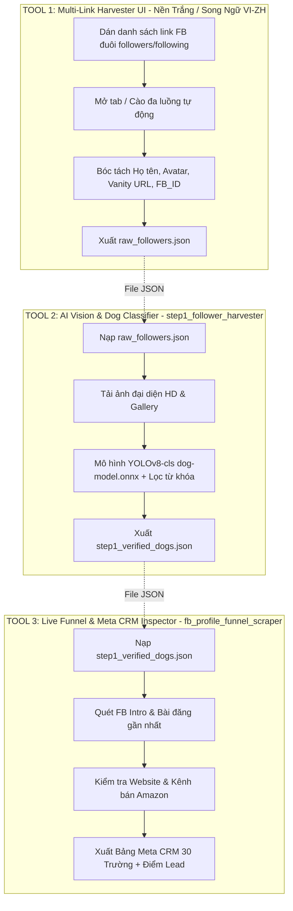

# Kế Hoạch Chuẩn Hóa Hệ Thống 3 Tool Độc Lập & Dọn Dẹp Workspace

> **Mục tiêu**: Tách biệt hoàn toàn luồng xử lý thành **3 Tool độc lập** (không phụ thuộc điều hướng chéo), xây dựng **Giao diện Trắng (Light Mode) thẩm mỹ cao, song ngữ Việt - Trung** cho bộ cào link đa tab, giữ vững bộ nhận diện AI thị giác của Tool 2 và bộ quét tổng hợp CRM của Tool 3, đồng thời dọn dẹp sạch sẽ các tệp tin/thư mục rác trong workspace.

---

## 1. Kiến Trúc 3 Tool Độc Lập (Decoupled 3-Tool Pipeline)

---

## 2. Chi Tiết Thiết Kế & Chức Năng Từng Tool

### 🛠️ TOOL 1: FB Multi-Link Harvester (Giao diện Web Trắng độc lập)
* **Vị trí**: Tạo giao diện bảng điều khiển độc lập `Pet_Lead_AI_System/step1_harvester_ui/` (và liên kết với extension).
* **Thiết kế giao diện (Design System)**:
  * **Theme**: Nền trắng ngọc trai (`#ffffff` / `#f8fafc`), viền xám tinh tế (`#e2e8f0`), đổ bóng nhẹ (`box-shadow: 0 4px 20px rgba(0,0,0,0.05)`).
  * **Thẩm mỹ cao**: Font chữ hiện đại (Inter / Be Vietnam Pro / PingFang SC), thẻ card bo tròn 16px, icon sinh động, phân tách khối rõ ràng.
  * **Ngôn ngữ**: Nút chuyển đổi nhanh **Tiếng Việt (VI)** 🇻🇳 và **Tiếng Trung (ZH)** 🇨🇳 ở góc trên cùng.
* **Tính năng cốt lõi**:
  1. **Khung nhập danh sách URL (Batch URL Input)**:
     - Cho phép dán nhiều link Facebook mỗi dòng một link (ví dụ: `https://www.facebook.com/officialgooddog/followers`, `https://www.facebook.com/akcregistration/followers`).
     - Tự động chuẩn hóa link (loại bỏ tham số rác, kiểm tra định dạng `/followers` hoặc `/following`).
  2. **Quản lý đa tab / Đa luồng (Multi-Tab Task Runner)**:
     - Tùy chọn số lượng tab mở đồng thời (1, 2 hoặc 3 tab cùng lúc).
     - Nút **Bắt đầu cào tất cả link** (`Start All`), **Tạm dừng** (`Pause`), **Tiếp tục** (`Resume`).
     - Hiển thị tiến trình từng link: Đang cào | Đã cào X người | Hoàn tất.
  3. **Bảng kết quả trực quan (Live Table)**:
     - Hiển thị danh sách người dùng vừa cào: Avatar tròn, Họ tên, Link FB, FB_ID (nếu có), Tên trang nguồn.
  4. **Xuất dữ liệu 1-Click**:
     - Nút xuất file `raw_followers.json` chuẩn cấu trúc để sẵn sàng nạp trực tiếp vào Tool 2.

---

### 🧠 TOOL 2: AI Vision & Keyword Dog Classifier (`step1_follower_harvester`)
* **Vị trí**: `c:\Users\ASUS\Downloads\Marketing_Pet&Grass\Pet_Lead_AI_System\step1_follower_harvester` *(Giữ nguyên cấu trúc thư mục như yêu cầu)*.
* **Nhiệm vụ**:
  - Nhận file JSON từ Tool 1.
  - Tải ảnh đại diện và ảnh bài viết về thư mục cục bộ.
  - Chạy mô hình AI thị giác `models/dog-model.onnx` (YOLOv8-cls 224x224 RGB) để thẩm định độ tin cậy cún cưng (Confidence Score $\ge 0.65$).
  - Đối chiếu từ điển giống chó và từ khóa trại chó Mỹ (`kennel`, `breeder`, `puppy`, `litter`...).
  - Giao diện Gallery xem ảnh và duyệt hồ sơ trước khi xuất `step1_verified_dogs.json`.

---

### 📊 TOOL 3: Profile Funnel & Meta CRM Inspector (`fb_profile_funnel_scraper`)
* **Vị trí**: `c:\Users\ASUS\Downloads\Marketing_Pet&Grass\fb_profile_funnel_scraper`
* **Nhiệm vụ**:
  - Nhận danh sách các chủ trại đã vượt qua thẩm định AI từ Tool 2.
  - Mở tab trình duyệt bóc tách chi tiết:
    - Facebook Intro, Bio, Số điện thoại, Email.
    - Thời gian bài đăng gần nhất (`publish_time` chuẩn xác).
    - Website chính thức của trại (bóc tách tên người đại diện/chủ trại).
    - Kiểm tra liên kết **Amazon Storefront / Affiliate** (sản phẩm Pet Toys / Cỏ nhân tạo / Khay vệ sinh).
  - Tự động chấm điểm khách hàng tiềm năng ($0 - 100$ điểm) và cập nhật vào bảng Meta CRM.

---

## 3. Kế Hoạch Dọn Dẹp & Tổ Chức Workspace

Trước khi code giao diện mới, tiến hành dọn dẹp các file rác, file tạm để cây thư mục gọn gàng, tăng tốc độ hệ thống:

### 🗑️ Các mục cần dọn dẹp và xóa bỏ:
1. **Các thư mục tạm / thừa ở thư mục gốc**:
   - `video_frames/`, `scratch/`, `__pycache__/`
   - Các file video kiểm thử đã xong: `11.mp4`, `Recording 2026-10-16 150400.mp4`, `Recording 2026-10-17 202112.mp4`, `Recording 2026-10-19 020236.mp4`
   - Các file script test nháp ở thư mục gốc: `test_rag_query.py`, `test_qwen_extractor.py`, `repair_crm.py`, `locdulieu.py`...
2. **Loại bỏ các bản sao extension không còn sử dụng**:
   - Thư mục `extension/` (bản cũ không dùng), `facebookPageInfo/`, `facebook_business_contacts/`, `facebook_id_finder_extension/`, `fb_csv_contact_scraper/`.
3. **Giữ nguyên tuyệt đối**:
   - Thư mục `Datasets/` (bộ dữ liệu gốc, thông số marketing, tiêu chí phân loại).
   - Thư mục `Pet_Lead_AI_System/step1_follower_harvester` (Tool 2).
   - Thư mục `fb_profile_funnel_scraper` (Tool 3).
   - Thư mục `fb_following_scraper` (Extension đang hoạt động).

---

## 4. Lộ Trình Triển Khai Chi Tiết (Execution Roadmap)

| Giai đoạn | Nội dung công việc | Kết quả đầu ra |
| :--- | :--- | :--- |
| **Giai đoạn 1** | **Dọn dẹp thư mục & Chuẩn hóa cấu trúc** - Xóa các video mp4 test cũ, tệp py nháp ở root. - Dọn dẹp cache và thư mục thừa. | Workspace sạch đẹp, ngăn nắp. |
| **Giai đoạn 2** | **Xây dựng Tool 1 (FB Multi-Link Harvester Web UI)** - Thiết kế file `harvester_dashboard.html`, `harvester_styles.css`, `harvester_app.js`. - Tone màu: Nền trắng ngọc trai, card bo tròn, font chữ tinh tế. - Khung dán danh sách URL (mỗi dòng 1 link). - Tích hợp song ngữ Việt - Trung (VI / ZH switch). - Cơ chế mở tab và cào đa link qua Extension Bridge. - Bảng dữ liệu realtime + Nút xuất JSON cho Tool 2. | Giao diện Tool 1 hoàn chỉnh, độc lập, thẩm mỹ cao. |
| **Giai đoạn 3** | **Đóng gói luồng nhận dữ liệu cho Tool 2 & Tool 3** - Chuẩn hóa định dạng JSON đầu ra của Tool 1 khớp 100% với đầu vào của Tool 2 (`step1_follower_harvester`). - Chuẩn hóa đầu ra của Tool 2 khớp 100% với đầu vào của Tool 3 (`fb_profile_funnel_scraper`). | 3 Tool hoạt động độc lập, trao đổi qua file JSON rõ ràng. |
| **Giai đoạn 4** | **Kiểm thử thực tế (End-to-End Test)** - Thử nghiệm dán 2 link: `https://www.facebook.com/officialgooddog/followers` và 1 trang trại cún khác. - Kiểm tra chuyển đổi ngôn ngữ Việt - Trung. - Chạy thử luồng Tool 1 -> Tool 2 -> Tool 3. | Hệ thống hoạt động trơn tru, không lỗi. |
